
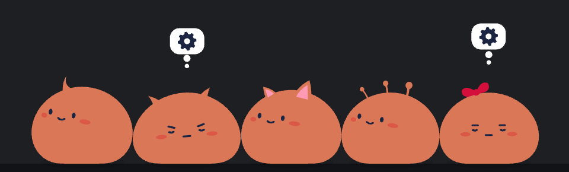

<h1 align="center">Blaube</h1>

<b>A squishy desktop buddy that keeps an eye on your Claude Code sessions.</b> 
Every session is a soft little blob on your screen. It shows you what Claude is doing, tells you when it needs you, and you can talk to it right there.

  
  
  
  

  <a href="https://github.com/syverlauritz/blaube/releases/latest/download/Blaube-mac-arm64.dmg"><b>Download for Mac (Apple Silicon)</b></a> ·
  <a href="https://github.com/syverlauritz/blaube/releases/latest/download/Blaube-mac-x64.dmg">Mac (Intel)</a> ·
  <a href="https://github.com/syverlauritz/blaube/releases/latest/download/Blaube-Setup-windows.exe"><b>Download for Windows</b></a>

---

## What Claude is doing, at a glance

Each Claude Code session (one per terminal) is its own blob, and its thought bubble shows what it's up to: a gear while it thinks, a magnifier while it reads, a pencil while it edits, a flask for tests, arrows for a push. Done, it bounces with a **!**. Waiting on you, it looks worried with a **?**.

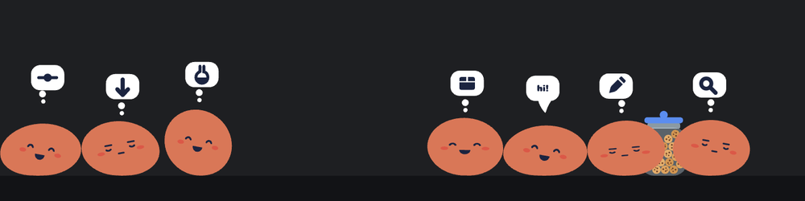

Every subagent a session sends off splits off as a little blob of its own, and merges back when it's done.

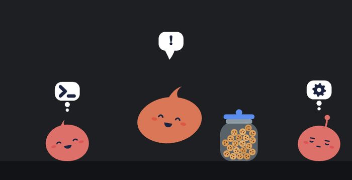

## Talk to it

Click a blob to talk to its session: read the conversation, send a message (it goes in at Claude's next step, like typing in the terminal), and answer permission prompts, questions and plans right on the blob. **New session…** in Blaube's menu starts one with no terminal at all.

<table>
  <tr>
    <td width="46%">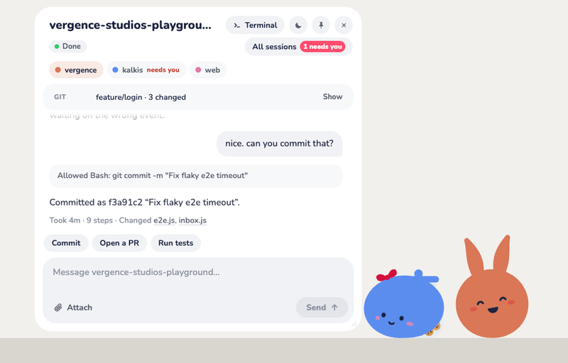</td>
    <td width="27%">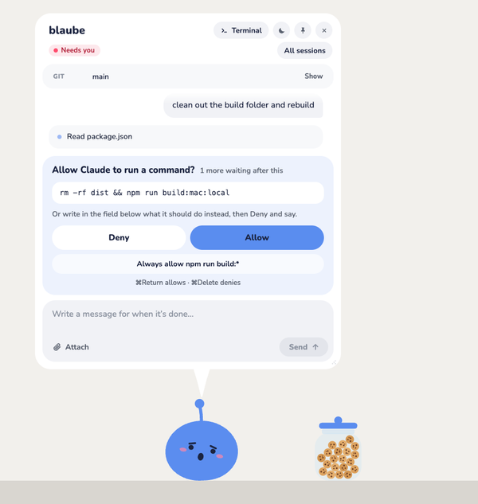</td>
    <td width="27%">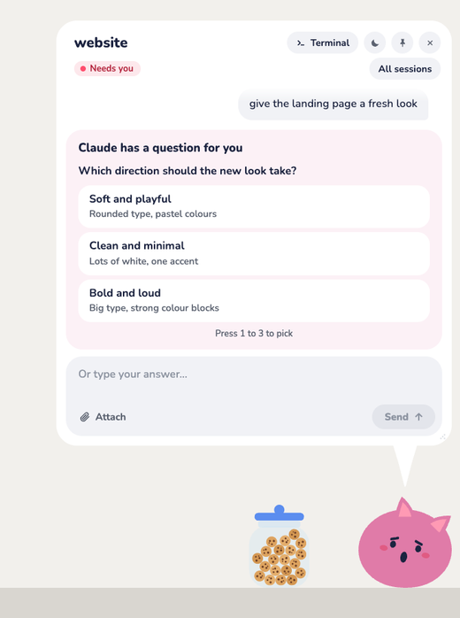</td>
  </tr>
  <tr>
    <td align="center">The conversation, with the next steps one click away</td>
    <td align="center">Allow or deny, right on the blob</td>
    <td align="center">Claude's questions, answered with a click</td>
  </tr>
</table>

## Which model, by its face

All blobs look alike, except for their faces: each model has its own eyes and blush, so you can tell them apart across the room.

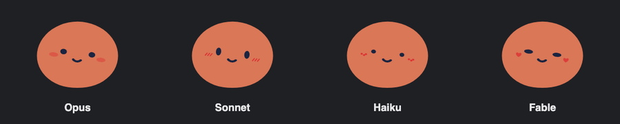

## The snack jar

A little cookie jar shows how much of your Claude usage limit is left: twenty cookies when your session's fresh, one fewer for each 5% used, each one tossed into a blob's mouth (nom). Hover it for the numbers. The cookies are real little things: shake the jar and they tumble about.

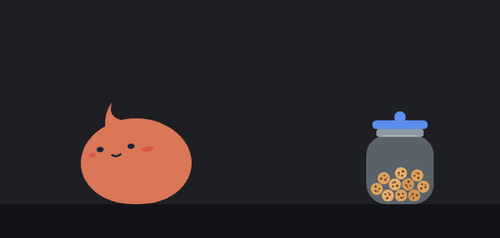 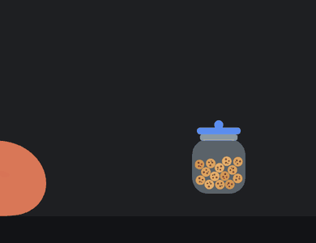

## Squishy, and full of life

They're real softbody physics: grab one anywhere and it hangs and swings from your cursor, fling it and it bounces off the screen edges, drop it on a window and it lands on top. Shake one too hard and it turns green and barfs. They also have plenty to do when nobody's looking: tag, leapfrog, towers, a balloon trick, the choir.

<table>
  <tr>
    <td>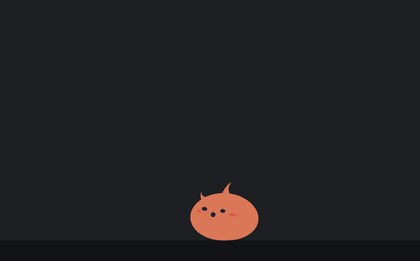</td>
    <td>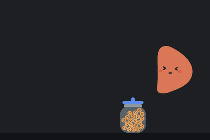</td>
    <td>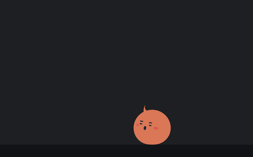</td>
  </tr>
  <tr>
    <td align="center">Hangs from wherever you hold it</td>
    <td align="center">Don't shake too hard</td>
    <td align="center">The balloon trick</td>
  </tr>
</table>

They babble what's in their speech bubbles in a little made-up language, and react to you: thank one and it blushes, swear at it and it gets scared. **[Everything they do →](docs/FEATURES.md)**

## Getting started

1. **Download** Blaube for [Mac (Apple Silicon)](https://github.com/syverlauritz/blaube/releases/latest/download/Blaube-mac-arm64.dmg), [Mac (Intel)](https://github.com/syverlauritz/blaube/releases/latest/download/Blaube-mac-x64.dmg) or [Windows](https://github.com/syverlauritz/blaube/releases/latest/download/Blaube-Setup-windows.exe). On a Mac, drag it into Applications; on Windows, run the installer (no admin needed).
2. **Open it** (the first time needs one extra click, see below).
3. **Connect:** right-click the blob and choose **Connect Claude Code…**. Then start or restart a Claude Code session, and its blob pops out.

Connecting adds Blaube's hooks to `~/.claude/settings.json` (a backup is saved as `settings.json.blaube-backup`, and your existing hooks are kept). Restart any running Claude Code sessions to pick them up. **Claude Code → Disconnect…** removes exactly what was added. If Claude Code isn't installed, Blaube says so and offers **Install Claude Code…**: after a dialog that shows what it runs, Blaube runs Claude Code's official installer itself (`curl -fsSL https://claude.ai/install.sh | bash`, or its PowerShell twin on Windows, as the setup page has you paste into a terminal), then has you sign in through your browser. No terminal needed (**Show me how instead** opens the setup page).

Want to see it without Claude running? Choose **Play → Demo sessions** from the menu.

### Your first five minutes

1. Connect (above), then start or restart a Claude Code session: its blob pops out.
2. Hover a blob for its name and what it's doing; **click** it to talk to the session; **⌥/Alt-click** to jump to its terminal; **right-click** for everything else.
3. When Claude asks for permission, a question or a plan, answer on the blob (or in the terminal; first answer wins).
4. **New session…** in Blaube's menu starts one with no terminal at all.
5. Throw them around. They like it.

### First launch (builds aren't notarized yet)

- **macOS:** open Blaube once and dismiss the warning ("Apple could not verify…"). Then go to **System Settings → Privacy & Security**, scroll down to "Blaube was blocked" and click **Open Anyway**. (On recent macOS, right-click → Open no longer skips this.) Or in Terminal: `xattr -dr com.apple.quarantine /Applications/Blaube.app`
- **Windows:** SmartScreen may warn you. Choose **More info → Run anyway**.

### Updates

Blaube looks for a new version when it starts and every four hours after that; **Check for updates…**, under the version at the top of its menu, looks right away.

- **Windows:** the new version downloads in the background and is installed the next time you quit Blaube, or now with **Restart to update to x.y.z**.
- **macOS:** the menu says **Download Blaube x.y.z…**, which opens the release to download it and drag it over the old one. (macOS only lets an app replace itself when it's signed with a Developer ID; once the build is signed ([see how](docs/DEVELOPMENT.md#signing-and-notarizing-the-mac-build)), Macs update like Windows does.)

## No API tokens, nothing leaves your computer

Blaube never calls the Anthropic API. It hears from your sessions through Claude Code's own hooks, sent to a tiny server on `127.0.0.1`, and every Claude Code it starts uses your Claude login, never an API key. Only sessions running on your computer show up. [More on how it works →](docs/FEATURES.md#no-api-tokens)

## More

- **[Everything Blaube does](docs/FEATURES.md)**: the full list, the hidden tuning panel, how it works, known issues.
- **[Developing Blaube](docs/DEVELOPMENT.md)**: running from source, tests, the render harness, releasing, signing.
- **[Changelog](CHANGELOG.md)** · **[Design brief](docs/DESIGN.md)** · **[Report a problem](https://github.com/syverlauritz/blaube/issues/new/choose)**

*Blau* is German for blue, *blob* is a blob. It's orange now. You can work out the rest.

## License

[MIT](LICENSE)
